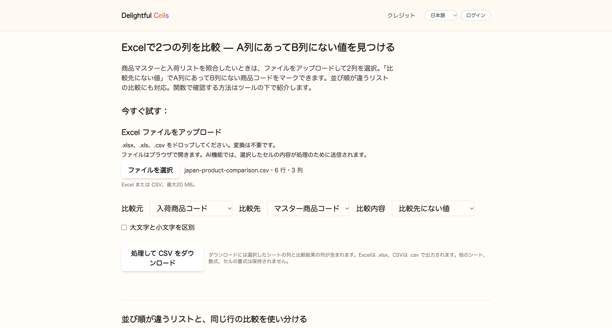
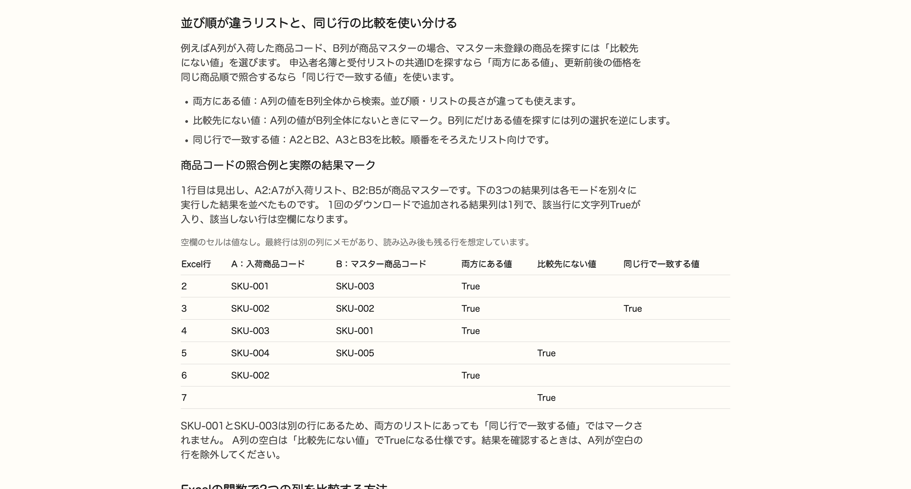

# Excelで「A列にあってB列にない値」を見つける方法｜関数とブラウザツール

商品マスターと入荷リストを照合するとき、「同じ行が一致しているか」と「別の列のどこかに同じ値があるか」は、違う比較です。

この記事では、並び順も長さも違う2つのリストから、A列にあってB列にない商品コードを探します。Excelの関数で確認する方法と、関数を使わずに結果列を追加する方法を紹介します。

なお、後半で紹介する「Delightful Cells」は私が開発しているツールです。サンプルは架空の商品コードです。

## まず、見つけたい結果を確認する

A列を入荷リスト、B列を商品マスターとします。1行目は見出しです。

| Excelの行 | A：入荷商品コード | B：マスター商品コード | メモ |
| --- | --- | --- | --- |
| 2 | SKU-001 | SKU-003 | |
| 3 | SKU-002 | SKU-002 | |
| 4 | SKU-003 | SKU-001 | |
| 5 | SKU-004 | SKU-005 | |
| 6 | SKU-002 | | |
| 7 | | | 空白の比較行 |

今回、見つけたい商品コードは **SKU-004** です。B列のどこにも登録されていません。

SKU-001とSKU-003は違う行にありますが、両方のリストに存在します。SKU-002は入荷リストに2回ありますが、これもマスターに登録されています。SKU-005はB列にだけある値なので、「A列にあってB列にない値」の対象ではありません。

7行目は、比較する2列は空白でも、別の列にメモがある場合を確認するための行です。

## 方法1：COUNTIFで、A列の値をB列全体から探す

D1に「マスター未登録」と入力し、D2に次の式を入力します。C列のメモは残します。

```excel
=IF(A2="","",IF(COUNTIF($B$2:$B$5,A2)=0,"B列にない",""))
```

D2をD7までコピーすると、SKU-004の行だけに「B列にない」と表示されます。

- `COUNTIF($B$2:$B$5,A2)`：B2:B5の中にA2の値が何件あるかを数えます。
- `=0`：1件も見つからない場合です。
- `$B$2:$B$5`：式を下へコピーしても検索範囲が動かないように固定します。
- 最初の`IF(A2="","",…)`：A列の空白を対象外にします。

実際の表では、B列の検索範囲とコピー先の最終行を自分のデータに合わせて変更してください。A列とB列を並べ替えたり、同じ行数にそろえたりする必要はありません。

両方の列にある商品コードを確認する場合は、条件を`>0`にします。

```excel
=IF(A2="","",IF(COUNTIF($B$2:$B$5,A2)>0,"両方にある",""))
```

この例ではSKU-001、SKU-002、SKU-003が対象です。SKU-002の2行ともマークされます。重複行を1つにまとめる操作ではありません。

COUNTIFは大文字・小文字を区別しません。また、`*`と`?`はワイルドカードです。上の式は、それらの記号を含まない商品コードを想定しています。余分な空白が混在している場合は、照合前にデータを整えてください。

## 「同じ行で一致しない値」を探したい場合

例えば、更新前と更新後の価格が同じ商品順に並んでいる場合は、行ごとの比較を使います。

```excel
=IF(A2=B2,"一致","不一致")
```

これはA2とB2、A3とB3を比較する式です。リストの別の行に同じ値があっても、その行の値が違えば「不一致」になります。上の商品コード例ではSKU-002が並ぶ3行目が一致し、両方空白の7行目も一致します。

大文字・小文字も区別するなら、`=IF(EXACT(A2,B2),"一致","不一致")`を使います。

## 方法2：関数なしで、ブラウザから比較結果を追加する

関数の入力やコピーを省きたい場合は、[Delightful Cellsの2列比較ツール](https://delightfulcells.com/ja/compare-two-columns-in-excel)でも確認できます。

1. Excel（.xlsx、.xls）またはCSVファイルをアップロードします。複数のシートがある場合は対象のシートを選びます。
2. 「比較元」で「入荷商品コード」、「比較先」で「マスター商品コード」を選びます。
3. 「比較内容」で **「比較先にない値」** を選びます。
4. 必要なら「大文字と小文字を区別」をオンにします。
5. 「処理して Excel をダウンロード」または「処理して CSV をダウンロード」を押します。



出力には、元のデータに加えて`missing_items_入荷商品コード_マスター商品コード`という結果列が追加されます。条件に当てはまる行には文字列`True`、それ以外には空欄が入ります。

| 入荷商品コード | マスター商品コード | missing_items_入荷商品コード_マスター商品コード |
| --- | --- | --- |
| SKU-001 | SKU-003 | |
| SKU-002 | SKU-002 | |
| SKU-003 | SKU-001 | |
| SKU-004 | SKU-005 | True |
| SKU-002 | | |
| | | True |

**現在のツールでは、A列の空白も「比較先にない値」としてTrueになります。** 先ほどのCOUNTIF式は空白を除外しているため、空白行の結果は異なります。

ダウンロード後、Excelの［データ］→［フィルター］で、結果列を`True`、入荷商品コードを空白以外に絞ると、確認したいSKU-004が残ります。ツール自体が該当行だけを抽出してダウンロードするわけではありません。

ほかの比較をする場合は、次のように選びます。

| 確認したいこと | 比較内容 | このサンプルの結果 |
| --- | --- | --- |
| 両方のリストにある商品 | 両方にある値 | SKU-001、SKU-002、SKU-003。SKU-002は2行ともTrue |
| A列にあってB列にない商品 | 比較先にない値 | SKU-004とA列空白の行がTrue |
| 同じ行の2つの値が一致 | 同じ行で一致する値 | 3行目だけTrue。両方空白の行は空欄 |

この3つの結果は別々の実行です。1回の処理で追加される結果列は1列です。

「同じ行で一致する値」で一致しない行を確認する場合は、結果列が空欄の行を見ます。ただし、両方空白の行も空欄になるため、必要に応じて除外してください。B列にあってA列にない商品を探す場合は、比較元と比較先を入れ替えます。



## 使う前に確認しておきたい範囲

- この2列比較ツールでは、ファイルの読み込み・比較・出力をブラウザ内で行います。別のAI抽出機能は、選択したセル内容を処理のためサーバーに送信します。
- 比較前に文字列の前後の空白を取り除きます。大文字・小文字は初期設定では区別せず、設定で区別できます。`*`と`?`は通常の文字として比較するため、COUNTIFのワイルドカード検索とは異なります。
- 元ファイルは変更しません。出力は選択したシートのデータと結果列のみです。**他のシート・数式・元の書式は保持しません。** Excelは.xlsx、CSVは.csvで出力されます。

元のブックの数式や書式を保ったまま作業を続けたいなら、Excel内で結果列に関数を入れる方法が適しています。データのコピーに比較用の列を追加して確認したいなら、ブラウザツールも使えます。

まずは「別の列全体から探す」のか「同じ行同士を比べる」のかを決めると、比較方法を選びやすくなります。
